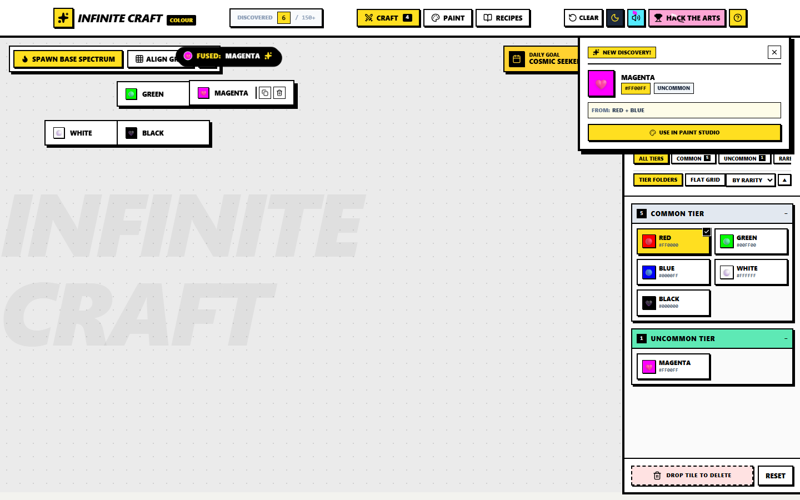
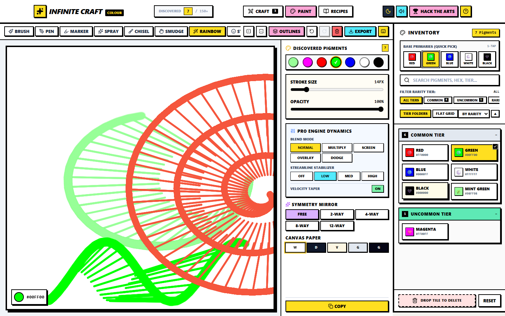

# INFINITE COLOUR CRAFT

My idea was to make something like [Infinite Craft](https://neal.fun/infinite-craft/), but with colours. You start with red, green, blue, white and black, and you gotta mix them to discover more colours.

But then what do you do with all those colours?

Paint with them. There is a whole painting studio in the game too.

My idea in play: **[game](https://hustlenix.github.io/Infinite-Colour-Craft/)**



## Play

I published it on GitHub Pages, and am using github for version control.

**[Play](https://hustlenix.github.io/Infinite-Colour-Craft/)** · **[Latest work](https://github.com/Hustlenix/Infinite-Colour-Craft/tree/codex/ai-grimoire-fixes)**

The latest fixes are on that branch, they aren't on the live game yet.

Drag one colour onto another to mix them. Find a colour you like, open Studio, and draw something with it. You can save your drawing as a PNG.

**TRY THE STUDIO TOO!** Mixing is only half the game✌🏻



## The other stuff

I also added **AI Lab** and **Grimoire**.

AI Lab guesses your doodles, and there is a five-round drawing challenge. The model runs in your browser, no API key needed. It only knows these ten things: cat, dog, bird, fish, flower, tree, star, clock, car and book. So if you draw something else, dont expect it to magically know🤣

Grimoire has your recipes, palettes, quests and the daily challenge. You can edit your palettes and copy the colours out as HEX, CSS, Tailwind or JSON.

The mixes are game recipes and colour maths, so this isn't a science lesson about how real paint behaves.

## Verified status

Want to see what was actually checked?

See: [test results, screenshots and the remaining limits](docs/AI-GRIMOIRE-FIXES.md).

The AI Lab and Grimoire fixes passed 112 unit tests, 20 browser tests and 3 production browser checks at commit `44dae94`. The newer visual changes are still being worked on locally.

Your discovered colours and palettes stay in browser storage. **Export paintings you want to keep** — the version pushed here doesn't recover paintings after a refresh yet.

## Run it yourself

**Dependency**

Node.js and npm. I used Node.js 24 for the local checks.

**Command**

```sh
git clone https://github.com/Hustlenix/Infinite-Colour-Craft.git
cd Infinite-Colour-Craft
git switch codex/ai-grimoire-fixes
npm ci
npm run dev
```

Open http://localhost:3000/.

For checks and a build:

```sh
npm run lint
npm test
npx playwright install chromium
npm run test:e2e
npm run build
```

For the GitHub Pages build, use `npm run build:pages`. You can check that build with `npm run test:pages`.

Multiplayer needs a running relay or a configured Supabase project. The local server includes a relay; GitHub Pages only hosts the static game.

## Built with

React, TypeScript, Vite, Tailwind, Canvas 2D and Web Audio. The doodle model uses ten categories from Google's [Quick, Draw! dataset](https://github.com/googlecreativelab/quickdraw-dataset). AI coding tools helped with the implementation and fixes too.

Icons are from [Lucide](https://lucide.dev/), celebrations use [canvas-confetti](https://github.com/catdad/canvas-confetti), and the sounds are made in the browser. Thanks to the people behind those projects.

## Licence

[MIT](LICENSE). Dependencies and datasets have their own licences.
